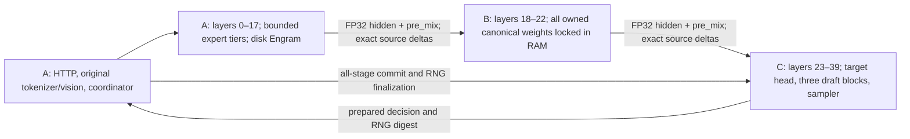

# Whole-runtime review guide

Read IMPLEMENTATION_SPEC.md together with DECISIONS.md first. The latter records
the user's overriding requirements: all three PCs run Windows 11; BF16-only
unquantized KV/index caches; FP32 stage hidden/pre-mix wire; no optional FP16
cache mode; existing DeepSeekRPC repository; neutral author identity; Windows
CI/push/merge authorization; no cloud model payloads, rented GPUs or personal VM
dependency. The user wants the complete source before the first Astra handoff.

This guide is navigation for that review, not independent approval. The packet
must identify its exact source revision and actual Windows build/install/CPU
results. All GPU/model results remain unrun until the later hardware phase.
Open findings in FINDINGS.md stay open even if a later test run passes.

## Execution and ownership

The diagram shows the default 18/5/17 split. StagePlan derives ownership and
replica dependencies for admitted splits; roles must not infer source ownership
from a local layer number. Control traffic has separate bounded authenticated
connections and independent cancellation/heartbeat handling. Publication waits
for actual GPU finishes, unanimous history commits and Stage C RNG finalization.

## Source map

| Surface | Primary files | Review boundary |
| --- | --- | --- |
| Installed graph and ownership | `bootstrap.py`, `stage_graph.py`, `native_weights.py`, `dense_weights.py`, `runtime_memory.py` | Only owned target/vision/draft/native tensors are built and loaded; C's embedding replica and every scratch/persistent allocation are admitted. |
| Physical packed weights | `inventory.py`, `weights.py`, `resident_weights.py`, `packed.py`, `routed_experts.py`, `cuda_cache.py`, `vllm_experts.py` | All real K/trellis/rotation layouts, tile counts, all routed/shared experts, lease/stream lifetimes, BF16 caller boundaries and pre-w2 routing weights. |
| B residency | `native_windows.py`, `resident_weights.py`, `native/windows_memory.cpp` | All canonical owned bytes stay physically resident after preload; every page is checked, files are closed, upload uses one bounded tile and no inference-time application disk fallback exists. |
| Attention and state | `vllm_attention.py`, `compression_state.py`, `attention_state.py`, `cache_pool.py`, `index_selection.py`, native `operations.cu` | Causal versus full encoder visibility, exact source/index ownership, BF16 bytes/generations, FP32 compressor pairs, candidate/top-k semantics, independent shadow storage and undo at every accepted prefix. |
| mHC and graph precision | `vllm_mhc.py`, `stage_graph.py`, `stage_data.py`, `runtime_policy.py`, `triton_policy.py` | Previous pre-mix timing, entering-layer residual means, last pre-mix collapse, BF16 rounding and FP32 wire; no hidden INT8, TF32, interpreter or kernel override path. |
| Engram and images | `vllm_engram.py`, `engram_storage.py`, `engram_history.py`, `vision_input.py`, `vision_runtime.py`, `image_assets.py` | Original hashes/compressed vocabulary, exact bounded rows, learned gating, original pixel/layout/embedding behavior, image spans and lifetime across reuse/restore. |
| CED and prefix reuse | `phases.py`, `coordinator.py`, `prefix.py`, `history.py`, `publication.py` | Full two-pass traversal and encoder barrier, 64-token/image-safe prefix anchors, complete target replay even on reuse, all-stage history and processed-versus-pending identities. |
| DSpark and sampling | `stage_graph.py`, `terminal_sampling.py`, `sampling.py`, `request_settings.py`, `cluster_probe.py` | Five bidirectional draft rows, persistent target-derived context, sequential Markov conditioning, identical prefix controls, exact rejection correction, EOS/length/stop clipping, transactional RNG and qualification gate. |
| Networking and recovery | `protocol.py`, `fragments.py`, `tensor_wire.py`, `transport.py`, `control_rpc.py`, `mesh.py`, `actor.py`, `stage_service.py` | Bounded framing/queues/replay, stream/event dependencies, peer/plane/run/incarnation identities, cancellation during queued or blocked work, unknown outcomes and coherent replacement. |
| Sessions and snapshots | `snapshot_archive.py`, `snapshot_state.py`, `snapshot_restore.py`, `snapshot_coordinator.py`, `snapshot_wire.py`, `http_snapshot.py`, `http_resume.py` | All-stage sealing, pinned deny-write/delete reads during both validation/apply passes, no live weights, bounded partial failures, exact BF16/source/pair/history/image/RNG/stop state and pending-input continuation. |
| HTTP/client | `api.py`, `api_runtime.py`, `http_request.py`, `chat_input.py`, `completion_parser.py`, `detokenize.py`, `admin_client.py` | Bounded original text/tool/image preparation, literal reasoning/tool output, reservation/thread/disconnect ownership, correct usage/finish/SSE semantics and clear rejection of unsupported controls. |
| Windows deployment | `worker.py`, `deployment_config.py`, `pki.py`, `bundle_launcher.py`, `packaging/Install.ps1`, `tools/build_bundle.py`, `tools/qualify_runtime.py` | Private interpreter, source/native identity and ABI, app-local DLLs, no global PATH/registration changes, credential ACLs, early loading diagnostics and persistent request cancellation/recovery. |
| Observability | `metrics.py`, `diagnostics.py`, `benchmark.py`, DIAGNOSTICS.md, OBSERVABILITY.md | Closed content-free logs, truthful timing/counter denominators, file reads versus physical SSD traffic, committed output accounting and no invented throughput. |

Paths in this table are relative to `src/deepseekrpc/` unless explicitly rooted
at `native/`, `packaging/`, `tools/` or the documentation directory.

## Fidelity questions that require particular scrutiny

1. Follow one target window from original tokens/images through all three real
   graph calls and every source/index publication. Verify full encoder visibility
   does not accidentally leak future tokens into encoder attention, or hide
   encoder tokens from the target pass.
2. Follow every accepted length 0..5, the full-acceptance bonus, EOS/stop inside
   drafts and context-tail normal decode. Account separately for forwarded seed,
   accepted target rows, published tokens and an unforwarded pending correction.
   Verify rejected/aborted state and RNG lifetimes rather than token IDs alone.
3. Check numerical boundaries against the frozen October methods and packed
   fixtures, including shared/routed accumulation, independent output-group
   rotations, compressor pairs, source/index RoPE and final mHC collapse.
   Exact storage and a dtype label alone are insufficient proof of fidelity.
4. Trace cancellation, disconnect, deadline and peer restart during every phase,
   upload, save and restore. Uncertain distributed state must not become READY
   or publish output. Retaining loaded weights must not retain a corrupted
   request/session or admit an overlapping GPU owner.
5. Verify prefix/snapshot identity and restoration include every dependency,
   image feature/history, exact source validity, compressor state, RNG, stops
   and pending input. Reuse must always retain full target replay.
6. Check B's actual closed-file resident source and bounded staging, not a
   pagefile-backed allocation or a local cache hit mistaken for physical pinning.
   Check the whole live stage's memory admission and lease ownership as well.

DEEPINFER_REVIEW.md compares the eighth official reference. Its 140-token replay
suffix and 5e-5 biased rejection residual are intentionally not adopted.
Confidence cannot choose a verification prefix from future conditional values.
New exact tiny joint-law fixtures complement existing deterministic branches;
none is an independent full-model golden.

## Evidence and later hardware phase

Read the exact per-run scope and hashes in the review packet, not just a green
workflow badge. Native build/import and offline compiler output do not execute
CUDA kernels. CPU fixtures use real libraries and independent equations;
synthetic networking/sampling fixtures do not emulate the complete model.
The Linux Torch 2.13 sqrt discrepancy remains DSR-AUDIT-011 until explained.

Only after the user-mediated review/fix cycles, use the isolated installation
instructions and local CUDA tests, then actual cluster qualification. The
speculation gate binds the current loaded components and mesh; a report file
cannot enable it. Full-model attention/replay/logit comparisons, long context,
all-page B residency under pressure, recovery, images, actual OpenCode and matched
performance must be tested on the three Windows PCs. No hardware result or
independent review approval is asserted by this guide.
